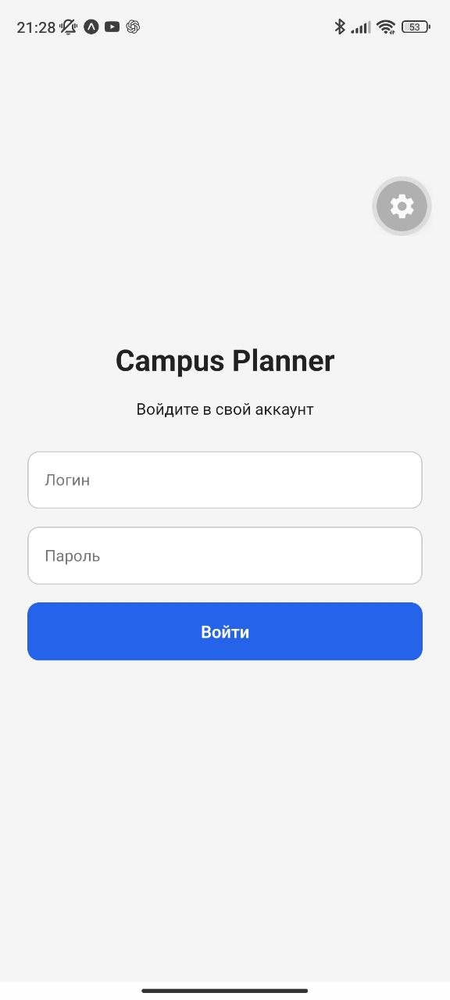
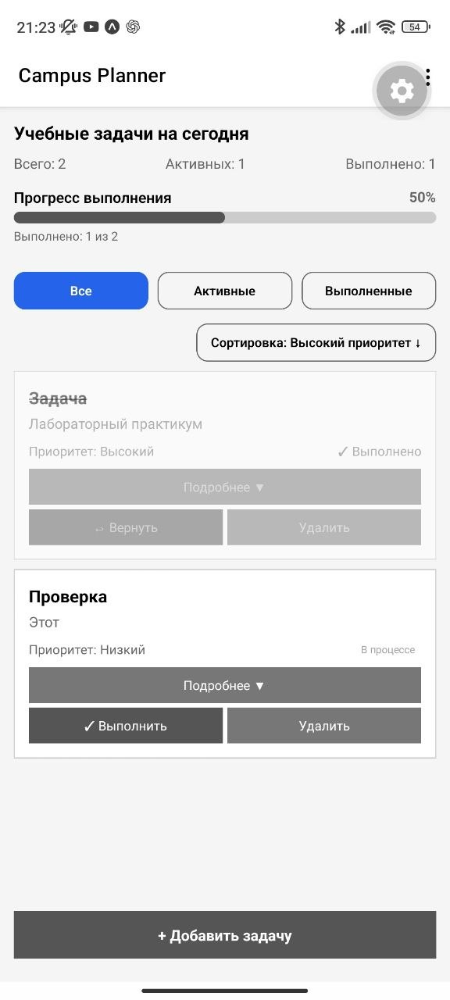
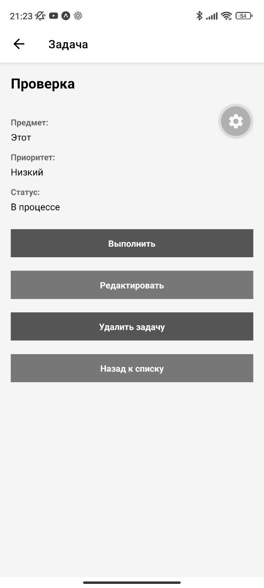
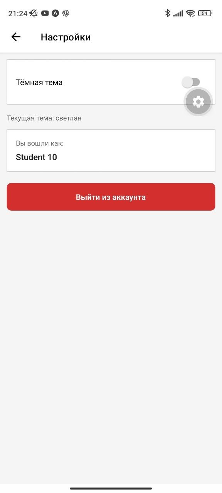

# Campus Planner

Мобильное приложение для организации учебных задач, контроля их выполнения и планирования учебной деятельности.

## 1. Описание проекта

**Campus Planner** — мобильное приложение, позволяющее студентам создавать и организовывать учебные задачи, отслеживать их выполнение, устанавливать приоритеты и управлять сроками.

Приложение использует серверное API для хранения данных и поддерживает авторизацию пользователей.

**Предметная ветка:** Campus Planner.

## 2. Основные возможности

- Авторизация и выход из учётной записи.
- Сохранение пользовательской сессии.
- Получение списка задач с сервера.
- Создание, просмотр, редактирование и удаление задач.
- Изменение статуса выполнения.
- Фильтрация задач по статусу: все, активные, выполненные.
- Сортировка задач по приоритету.
- Отображение статистики выполнения задач.
- Индикатор общего прогресса.
- Светлая и тёмная темы оформления.
- Анимация элементов интерфейса.
- Управление задачами с помощью свайпов.
- Обработка ошибок сети и отсутствующих записей.

## 3. Собственная функция

В рамках лабораторной работы №8 реализована собственная функция — **сортировка задач по приоритету**.

Пользователь может менять порядок отображения задач:

- Высокий → средний → низкий.
- Низкий → средний → высокий.

Сортировка выполняется на стороне приложения и не требует дополнительных запросов к серверу.

Дополнительно реализована фильтрация задач по статусу выполнения.

## 4. Используемые технологии

| Технология | Назначение |
|---|---|
| React Native | Разработка мобильного интерфейса |
| Expo SDK 57 | Среда разработки и запуска |
| TypeScript | Типизация кода |
| Expo Router | Навигация между экранами |
| TanStack Query | Получение данных, мутации и кэширование |
| React Context API | Управление авторизацией и темой |
| Expo SecureStore | Защищённое хранение токена |
| React Native Reanimated | Анимация интерфейса |
| React Native Gesture Handler | Обработка жестов и свайпов |
| Fetch API | Взаимодействие с сервером |

## 5. Структура проекта

```text
campus-planner/
├── app/
│   ├── (auth)/
│   ├── (app)/
│   │   ├── index.tsx
│   │   ├── settings.tsx
│   │   └── task/
│   └── _layout.tsx
├── src/
│   ├── api/
│   ├── auth/
│   ├── components/
│   ├── context/
│   ├── hooks/
│   ├── theme/
│   ├── types/
│   └── utils/
├── assets/
├── docs/
│   └── screenshots/
├── app.json
├── package.json
├── package-lock.json
└── README.md
```

## 6. Установка и запуск

Для работы с проектом необходимы:

- Node.js;
- npm;
- Expo Go, совместимый с Expo SDK 57, либо Android Emulator.

### Установка зависимостей

Откройте папку проекта и выполните:

```bash
npm install
```

### Настройка API

В корне проекта необходимо создать файл `.env`:

```env
EXPO_PUBLIC_API_URL=https://campus-api.mkseva.workers.dev
```

При необходимости адрес сервера можно заменить на другой адрес учебного API.

### Запуск приложения

```bash
npx expo start
```

Для запуска на Android Emulator:

```bash
npx expo start --android
```

После запуска можно отсканировать QR-код через совместимую версию Expo Go.

## 7. Взаимодействие с сервером

Приложение использует учебный Campus API.

Основные запросы:

| Метод | Endpoint | Назначение |
|---|---|---|
| POST | `/auth/login` | Авторизация |
| GET | `/auth/me` | Получение текущего пользователя |
| GET | `/tasks` | Получение списка задач |
| GET | `/tasks/:id` | Получение задачи |
| POST | `/tasks` | Создание задачи |
| PATCH | `/tasks/:id` | Изменение задачи |
| DELETE | `/tasks/:id` | Удаление задачи |

Для защищённых запросов используется токен доступа в заголовке:

```http
Authorization: Bearer <accessToken>
```

Для работы с серверными данными применяется TanStack Query. После успешного изменения задач кэш соответствующего списка обновляется.

## 8. Обработка ошибок

В приложении предусмотрена обработка следующих ситуаций:

- отсутствие интернет-соединения;
- ошибка ответа сервера;
- отсутствие запрашиваемой задачи;
- истечение или недействительность токена авторизации;
- отсутствие задач в списке.

При ошибках загрузки пользователь может повторить запрос. При получении ответа `401 Unauthorized` выполняется завершение пользовательской сессии и очистка кэша запросов.

## 9. Скриншоты приложения

### Авторизация



### Главный экран



### Добавление задачи


### Просмотр задачи



### Настройки



## 10. Итог

В результате разработки создано мобильное приложение Campus Planner, объединяющее авторизацию пользователей, взаимодействие с серверным API, управление учебными задачами, фильтрацию и сортировку данных, анимации и жестовое управление.

Приложение подготовлено в рамках лабораторных работ №1–8 по лабораторному практикуму.
